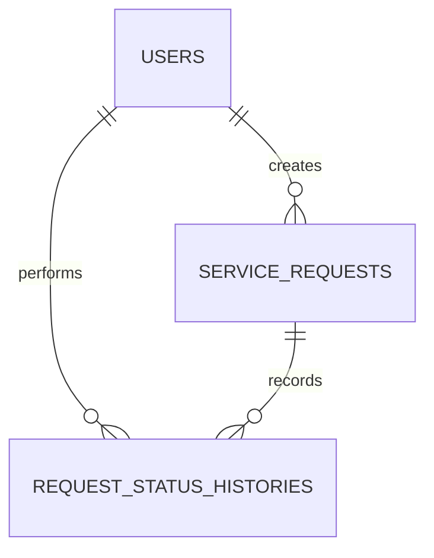

# Service Request Tracker — Architecture and Implementation Guide

Revision: 2 — corrected implementation order and clarified authentication authority.

Status: implementation plan, not evidence that an application has been built or tested. Checkboxes and acceptance gates below remain pending until the implementing agent or candidate records actual evidence.

Audience: the candidate and their IDE coding assistant. Read this entire document before implementing. The assignment supplied by the candidate is authoritative if a conflict is discovered. Keep the application explainable and achievable in approximately 6–8 focused hours, within the 72-hour submission window.

Start with the implementation sequence in section 3, then use the remaining sections as the detailed contract. Keep the separately supplied AI prompts outside this file. The existing companion `schema.sql` remains applicable; this revision changes implementation guidance, not the data model.

## 1. Outcome and scope

Build a compact, secure internal Service Request Tracker. Employees sign in, create requests, view only their own requests, and advance their requests through a controlled workflow. Every successful status change is audited. Stale writes must never silently overwrite a newer change.

Required stack: Laravel REST API, Next.js frontend with TypeScript, PostgreSQL, migrations and seeders. Use one Git repository with `backend/` and `frontend/` folders. Local development is sufficient.

Required UI: login/logout, owned request list, search and combined filters, server pagination, creation, detail, status actions, version display and chronological history.

Out of scope: public registration, password reset, email verification, administrators, request assignment, attachments, notifications, generic edit/delete endpoints, real-time updates, microservices and paid hosting. “Technician assigned” is an illustrative remark, not a requirement to build assignment functionality.

## 2. Architecture decisions

Choose the smallest design that enforces the assignment's guarantees. The reasons for session authentication are one first-party browser application, immediate server-side logout, no mobile/third-party clients, and a short implementation window. HttpOnly is a necessary cookie property within this design, not the reason to choose the architecture.

Laravel is the sole authority for identity, sessions, authorization, workflow and persistence. Next.js displays the application and sends user intent; it never independently decides whether an operation is permitted. PostgreSQL provides relational integrity and atomic persistence.

| Decision | Choice and reason |
| --- | --- |
| Frontend | Next.js App Router and TypeScript; minimal accessible styling |
| Private data fetching | Browser client components call Laravel directly; no extra Next.js backend or server-side cookie forwarding |
| Backend | One Laravel application using controllers, Form Requests, Resources, Eloquent and one status action |
| Database | PostgreSQL for relational constraints, transactions and row locking |
| Authentication | Sanctum SPA session cookies; no JWT or browser-stored bearer tokens |
| Session storage | Laravel database session driver; include `sessions` migration |
| Authorization | Query through the authenticated user's requests; consistent 404 for unknown and non-owned records |
| Concurrency | Expected-version check inside a transaction after acquiring a row lock |
| Workflow | One PHP enum owns allowed transitions; backend is authoritative |
| Audit | Synchronous insert in the same transaction as the update |
| Tests | Laravel feature tests using a dedicated PostgreSQL test database |

Use stable supported framework versions compatible with the installed PHP/Node runtimes. Verify official installation documentation, record exact versions and commit dependency lockfiles. Do not upgrade an existing compatible project merely to use a newer major release.

Keep controllers small. Use `ChangeRequestStatus` for the multi-step workflow; simple create/list/detail queries can remain in their controllers. Do not add NextAuth/Auth.js, a second credential store, JWT refresh-token machinery, repository interfaces, generic service frameworks, Redux, queues, Redis or large component libraries for this scope.

### Local runtime versus future deployment

The required implementation uses Next.js at `http://localhost:3000` and Laravel at `http://localhost:8000`, with exact credentialed CORS and Sanctum stateful configuration. Different ports make these different origins, so CORS still applies. PostgreSQL is reachable by Laravel, not the browser.

If deployment is later requested, prefer one public HTTPS origin: route application pages to Next.js and `/api/*` plus `/sanctum/csrf-cookie` to Laravel. This can reduce cross-origin configuration while preserving Laravel's authority. That routing/hosting work is not part of the local assignment. Do not introduce a reverse proxy, Next.js API proxy or container orchestration just for this submission.

### Required baseline versus optional additions

| Implement in this assignment | Defer unless separately required |
| --- | --- |
| Session auth, CSRF, exact CORS, login throttling and safe rendering | OAuth, JWT refresh flows, SSO, MFA or another auth provider |
| Owner-scoped queries and consistent errors | Organization-wide role/permission frameworks |
| Atomic workflow, version checks and synchronous audit | Events/queues for audit, distributed locks or event sourcing |
| Required Laravel tests plus focused browser checks | A large browser-test platform or performance suite |
| Migrations, seeders, environment templates and README | Cloud deployment and operational infrastructure |
| Basic responsive accessible screens | Animations, dashboards or UI-library customization |

Never defer a required acceptance criterion to protect the time budget. Reduce polish and optional infrastructure first. Report a real blocker rather than hiding an incomplete security or integrity requirement.

## 3. Implementation milestones and definition of done

Follow this order. Each phase includes its own verification; testing is not postponed until all code is written. Build the complete business UI after the backend contract and integrity behavior work, but verify browser cookie authentication with a minimal login page before implementing the remaining screens.

Work sequentially in small reviewable changes. Preserve existing user edits. Implement authorized local work without asking permission for every file; pause only for a real blocking ambiguity, destructive operation or access requirement. Do not deploy or publish unless separately requested. If a phase already exists, inspect and verify it instead of recreating it.

| Phase | Target time | Depends on | Completion gate |
| --- | --- | --- | --- |
| 0. Inspect and map requirements | 15 min | Specification and repository | Confirmed scope, runtimes and setup prerequisites |
| 1. Scaffold and database | 45 min | Phase 0 | Fresh migrations/seeders work; schema matches reference |
| 2. Backend authentication | 60 min | Phase 1 | Login/me/logout and unauthenticated tests pass |
| 3. Owned request API | 45 min | Phase 2 | Create/read/filter/history and cross-user tests pass |
| 4. Atomic workflow | 90 min | Phase 3 | Valid/invalid/stale/rollback behavior verified |
| 5. Browser authentication slice | 45 min | Phases 2–4 | Real cookies, CSRF, reload, logout and expiry work |
| 6. Request screens and conflict recovery | 90 min | Phase 5 | End-to-end owned request workflow works |
| 7. Delivery verification and documentation | 90 min | Phases 0–6 | Checks recorded, README/screenshots and submission identifiers ready |

Total planning budget: 8 hours. These are estimates, not claimed implementation times. Adjust based on actual progress and reduce optional work first.

### Phase 0 — Inspect before creating

- Read the full assignment, this guide, docs/schema.sql and applicable repository instructions.
- Inspect existing files and PHP/Node/PostgreSQL versions. Choose compatible supported dependencies and preserve existing compatible setup.
- Map acceptance criteria to endpoints, schema, UI and tests. Identify missing tools before attempting a build.
- Resolve configuration placeholders locally; do not paste credentials into chat or generated documentation.
- Record the intended test database and exact test commands. Do not run destructive setup against an existing non-test database.

Gate: a short implementation map exists; no product requirements have been invented. Missing local services are reported explicitly rather than replaced with mock authentication or a different database.

### Phase 1 — Database foundation and skeletons

- Scaffold backend/ and a minimal frontend/ if absent. Install required dependencies and commit lockfiles according to the user's Git workflow.
- Add .env.example files and keep real .env files ignored. Generate the Laravel application key locally.
- Create or adapt users/sessions migrations, then service_requests, then request_status_histories. Keep SQL-reference equivalence.
- Add enums, model relationships, factories and a local-only seeder with two users. Seed sample requests as OPEN/version 1; if seeding advanced states later, preserve matching history.
- Create a dedicated PostgreSQL test database. Verify migration and seeding on a fresh development database.

Gate: two users have hashed passwords; all four tables, constraints and indexes exist; both app skeletons can start. Do not build business screens yet.

### Phase 2 — Laravel authentication and error contract

- Configure database sessions, named HttpOnly session cookie, stateful API handling, exact credentialed CORS and CSRF protection.
- Implement login/me/logout through Laravel's web guard and auth:sanctum. Rotate session ID at login, invalidate session at logout and apply login throttling.
- Establish consistent JSON error rendering, including the documented unauthenticated/CSRF distinction. Keep CSRF active.
- Write and run real-credential authentication tests and 401 tests. Do not use actingAs as the only proof of login functionality.
- Verify session storage and framework configuration; distinguish code configuration from browser behavior not yet checked.

Gate: correct credentials work, incorrect credentials fail, /me resolves identity, logout removes authentication and unauthenticated protected routes fail. Browser-specific verification occurs in phase 5, not assumed here.

### Phase 3 — Owner-scoped request API

- Implement creation with server-assigned owner, OPEN and version 1; use allowlisted inputs.
- Implement owned list/detail/history, filters, literal title search and server pagination. Add deterministic ordering and Resources.
- Scope parent lookups before exposing history; apply consistent 404 for non-owned/unknown records.
- Write and run cross-user list/detail/history, creation/validation, combined-filter and pagination tests. History may be empty until phase 4.
- Record actual success/error response shapes for frontend integration.

Gate: required read/create endpoints are usable without the frontend, forbidden records are inaccessible, and invalid inputs cannot persist. Status mutations are the next phase, not a temporary unrestricted update endpoint.

### Phase 4 — Workflow and transactional audit

- Write behavior tests for the allowed transitions, invalid/no-op/terminal transitions and stale versions.
- Implement ChangeRequestStatus using the owned locked row, version comparison, workflow validation, version increment and history insert in one transaction.
- Add status endpoint ownership coverage and a rollback test that forces history insertion failure without bypassing the transaction.
- Run the relevant PostgreSQL test suite. Verify competing writes using independent connections/processes; label manual and automated evidence accurately.
- Confirm successful updates create exactly one audit entry; failed updates change neither request nor history.

Gate: all required backend behavior is implemented and at least the six assignment test categories are covered. Do not proceed by weakening integrity assertions to make tests pass.

### Phase 5 — Small browser authentication slice

- Implement only the shared fetch client, AuthProvider, minimal login/logout UI and authenticated layout first.
- Fetch the CSRF cookie, submit credentials with the header, initialize /me and handle 401/419/network failures.
- Inspect actual Set-Cookie/browser storage: HttpOnly session cookie, readable CSRF cookie, SameSite and environment-appropriate Secure flag.
- Test reload, login rotation, logout invalidation and expiry. For expiry testing, temporarily shorten session lifetime in a test/local configuration, then restore 120 minutes and clear cached config as required.
- Check CSRF rejection with the middleware actually enabled and exact-origin CORS. Do not fix integration problems by disabling CSRF or setting a wildcard allowed origin.

Gate: a real browser can establish and end a Laravel-owned session, reload identity, and receive the documented auth/CSRF failures. No fake tokens, hard-coded logged-in state or second auth system remain.

### Phase 6 — Full request UI against verified endpoints

- Implement list, search/filter/pagination, creation, and detail/history screens against actual response shapes.
- Add allowed status actions with expected_version; handle stale conflicts by refreshing and requiring a new user decision.
- Include loading, empty, validation, authorization, API/network failure and pending-submit states. Prevent old fetches from overwriting newer results.
- Render user content as text and clear private data on logout/user changes. Use basic accessible responsive styling.
- Run available lint, TypeScript and production-build checks; fix real failures.

Gate: the full workflow works for both demo users, no cross-user content is shown, and a two-tab stale update produces clear recovery with no duplicate audit row.

### Phase 7 — Evidence and submission

- Run the final backend suite and relevant frontend checks after changes. Record actual commands/results and unresolved limitations.
- Complete the focused browser/security checks in the acceptance section, including literal XSS-string rendering and session invalidation.
- Verify the documented setup on a fresh database/configuration, without destructive operations on the working database.
- Capture genuine screenshots of login and the request workflow. Confirm README commands, local-only demo credentials and response shapes are accurate.
- Write AI Use & Verification from actual prompts, verification and candidate decisions. Leave unverified statements explicit; never invent evidence.
- Record repository URL, branch and exact final commit. Do not fabricate a URL/commit if the repository has not been created or pushed; report what remains.

Gate: the candidate can reproduce setup, demonstrate the workflow, explain the lock/transaction/session decisions and identify anything not tested.

### Progress reporting

At each phase, report changed behavior, relevant files, checks actually run, observed results and open issues. Fix failures before building dependent behavior. Make meaningful commits when authorized. Run the scripts supported by the actual project rather than inventing a successful command.

Required integrity and security behavior take precedence over polish. Do not mark phases complete because files exist. A local environment limitation is a blocker to verification, not permission to claim a passing check.

### Final README contents

The README must include:

- Prerequisites and exact PHP/Node/framework/PostgreSQL versions used.
- Reproducible install, environment, key-generation, migration, seed and run commands for both applications.
- Dedicated test database setup, backend tests and frontend checks.
- Two local demo accounts, API response shapes and ownership/HTTP semantics.
- Authentication choice, HttpOnly versus XSRF cookie distinction, local HTTP exception and session expiry/logout.
- Concurrency algorithm and transactional audit explanation; what was actually tested.
- Real workflow screenshots, known limitations and any incomplete checks.
- Repository URL, branch and exact final commit for submission.
- The mandatory **AI Use & Verification** section described below.

## 4. Repository and module structure

Root files:

```text
ARCHITECTURE.md
README.md
backend/
frontend/
docs/schema.sql
docs/screenshots/
```

The separately supplied `schema.sql` belongs at `docs/schema.sql` in the project. Laravel migrations are the normal application setup mechanism; the SQL script is a matching reference and an optional standalone schema bootstrap for a separate empty database. Do not run both against the same database.

### Backend application files

| Path relative to backend/ | Responsibility |
| --- | --- |
| `app/Models/User.php` | User, password hashing and owned requests relationship |
| `app/Models/ServiceRequest.php` | Request fields, enum casts, creator and history relationships |
| `app/Models/RequestStatusHistory.php` | Audit entry; `UPDATED_AT = null` |
| `app/Enums/RequestStatus.php` | OPEN, IN_PROGRESS, RESOLVED and allowed next status |
| `app/Enums/RequestPriority.php` | LOW, MEDIUM, HIGH |
| `app/Http/Controllers/Api/AuthController.php` | Login, me, logout |
| `app/Http/Controllers/Api/ServiceRequestController.php` | Create, index and show |
| `app/Http/Controllers/Api/RequestStatusController.php` | Call status action and return updated resource |
| `app/Http/Controllers/Api/RequestHistoryController.php` | Authorize parent then read ordered history |
| `app/Http/Requests/LoginRequest.php` | Login input |
| `app/Http/Requests/StoreServiceRequest.php` | Creation input |
| `app/Http/Requests/ListServiceRequests.php` | Filter and pagination input |
| `app/Http/Requests/ChangeRequestStatusRequest.php` | Status-change input |
| `app/Http/Resources/ServiceRequestResource.php` | Explicit public request fields |
| `app/Http/Resources/RequestStatusHistoryResource.php` | Explicit public history fields |
| `app/Actions/ChangeRequestStatus.php` | Ownership, lock, version, workflow, update and history transaction |
| `routes/api.php` | Required API paths and authentication middleware |
| `bootstrap/app.php` | Stateful API middleware and JSON exception rendering for the selected Laravel version |
| `database/migrations/` | Users, sessions, requests, histories, constraints and indexes |
| `database/factories/` | Small meaningful test fixtures |
| `database/seeders/DatabaseSeeder.php` | Two local demo users and owned sample requests |
| `tests/Feature/` | Auth, ownership, validation, filtering and integrity coverage |
| `.env.example` | Non-secret configuration template |

Use an existing generated users/sessions migration if present instead of creating duplicate tables. A Sanctum token table is not necessary for the chosen SPA design; do not issue personal access tokens.

### Frontend application files

```text
src/app/layout.tsx
src/app/login/page.tsx
src/app/(authenticated)/layout.tsx
src/app/(authenticated)/requests/page.tsx
src/app/(authenticated)/requests/new/page.tsx
src/app/(authenticated)/requests/[id]/page.tsx
src/components/auth-provider.tsx
src/components/request-form.tsx
src/components/request-filters.tsx
src/components/request-list.tsx
src/components/status-actions.tsx
src/components/status-history.tsx
src/components/pagination.tsx
src/lib/api.ts
src/lib/auth.ts
src/lib/requests.ts
src/types/api.ts
.env.example
```

The root route redirects to `/requests`; the authenticated layout decides whether login is needed. Client-side route protection improves UX; Laravel authorization provides security. Do not fetch sensitive records while auth state is unknown. Do not cache private records in a shared server cache or persist them in localStorage.

## 5. Data model and constraints



### users

Laravel-compatible user fields: `id`, `name`, unique `email`, hashed `password`, nullable `email_verified_at`, nullable `remember_token`, `created_at`, `updated_at`. Verification and remember-me functionality are not exposed. Normalize email consistently when seeding and logging in. Never return password or remember_token.

### service_requests

| Field | Constraint |
| --- | --- |
| id | Big integer primary key |
| created_by | Non-null FK to users; set from authenticated user |
| title | 3–100 characters |
| description | 10–500 characters |
| priority | LOW, MEDIUM or HIGH; required |
| status | OPEN, IN_PROGRESS or RESOLVED; default OPEN |
| version | Positive integer; default 1 |
| created_at / updated_at | UTC timestamps |

Index `(created_by, created_at DESC, id DESC)` for owned chronological lists. For this small assignment, filter within the owned records; add specialized indexes only if measurements justify them. A normal B-tree title index does not accelerate arbitrary `%substring%` searches.

### request_status_histories

| Field | Constraint |
| --- | --- |
| id | Big integer primary key |
| service_request_id | Non-null FK to service_requests |
| actor_user_id | Non-null FK to users; set from authenticated user |
| from_status / to_status | Valid status values and one of the two allowed transition pairs |
| remark | Nullable text, maximum 500 characters; this limit is a documented project decision |
| created_at | UTC timestamp; no updated_at |

Index `(service_request_id, created_at, id)`. Index `actor_user_id` for the FK. Use restrictive deletion for business/audit foreign keys; no deletion API is required. Do not allow editing history through API endpoints. Application code inserts history only through the status action; this is an audit trail, not a tamper-proof ledger against database administrators.

No history entry is needed on initial creation because there has been no status transition. Store from/to values and actor explicitly. Do not infer audit data later from the current request.

### sessions

Use Laravel's database-session layout: string primary key `id`, nullable `user_id`, nullable `ip_address` and `user_agent`, text `payload`, integer `last_activity`, indexes on user_id and last_activity. The SQL reference adds a nullable FK to users with ON DELETE SET NULL; mirror this in migrations. Do not expose session records through the API.

## 6. Authentication, cookies and session management

### Credential ownership

| Item | Owner / storage | Rule |
| --- | --- | --- |
| Typed login password | Login form temporarily, then Laravel request | Never persist or log it; clear it when leaving login or after success |
| Stored user password | Laravel users table | Hash through Laravel's supported hasher; never reversible encryption or plaintext |
| Authenticated session | Laravel database session driver | Browser receives only the framework session cookie, not a session JSON token |
| Session cookie | Browser, set by Laravel | HttpOnly; client code never copies or reads it |
| CSRF token | Sanctum XSRF-TOKEN cookie | Readable only to supply the CSRF header; not a login credential |
| Database password / APP_KEY | Backend private environment | Never put in frontend code, NEXT_PUBLIC variables, logs or Git |
| API origin | Frontend public environment | Safe to expose; contains no secret |

Use the framework's password/session mechanisms. No custom password hashing, encryption scheme, token signing or browser-managed session identifiers. Next.js stores only the current safe user representation in memory to render the UI; `/me` resolves identity after refresh.

### Cookie distinction — mandatory

The **authentication/session cookie must be HttpOnly**. JavaScript must not read, copy or store the session identifier. The browser sends it automatically with credentialed requests.

Sanctum also uses a separate **XSRF-TOKEN cookie**, which is intentionally readable by JavaScript so the client can copy its URL-decoded value into `X-XSRF-TOKEN`. This cookie is a CSRF token, not an authentication credential. Do not set it HttpOnly and thereby break Sanctum's standard SPA CSRF mechanism. If a later requirement insists that literally every cookie be HttpOnly, stop and explain that the CSRF token-delivery design must change; do not silently disable CSRF.

HttpOnly reduces session-cookie theft through JavaScript. It does not make the application immune to XSS: malicious scripts running on the application's origin can still perform actions using the victim's browser. Output encoding, avoiding unsafe rendering and server authorization remain necessary.

### Development configuration

Run both applications using the same hostname, never mix localhost and 127.0.0.1:

```dotenv
# backend/.env.example — placeholders only
APP_NAME="Service Request Tracker"
APP_ENV=local
APP_KEY=
APP_DEBUG=true
APP_URL=http://localhost:8000
FRONTEND_URL=http://localhost:3000

DB_CONNECTION=pgsql
DB_HOST=127.0.0.1
DB_PORT=5432
DB_DATABASE=service_request_tracker
DB_USERNAME=replace_me
DB_PASSWORD=

SESSION_DRIVER=database
SESSION_COOKIE=service_request_tracker_session
SESSION_LIFETIME=120
SESSION_DOMAIN=null
SESSION_SECURE_COOKIE=false
SESSION_HTTP_ONLY=true
SESSION_SAME_SITE=lax
SANCTUM_STATEFUL_DOMAINS=localhost:3000

CACHE_STORE=file
QUEUE_CONNECTION=sync
```

```dotenv
# frontend/.env.example — API origin is public, not a secret
NEXT_PUBLIC_API_URL=http://localhost:8000
```

Confirm the generated framework config actually reads these environment variables, especially `SESSION_HTTP_ONLY`; enforce `http_only => true` directly in session config if needed. `SESSION_DOMAIN=null` means a host-only cookie, not the literal string "null". Browser ports do not isolate cookies, so use a distinct application session cookie name.

Enable Sanctum stateful API handling for the selected Laravel version. Configure credentialed CORS with exactly `http://localhost:3000`, not `*`; allow the required methods and `Accept`, `Content-Type`, `X-XSRF-TOKEN` headers. Include `api/*` and `sanctum/csrf-cookie` paths. Validate environment-derived origins rather than reflecting arbitrary Origin headers.

Local plain HTTP uses `Secure=false`; this is a documented development exception. Any HTTPS deployment must use Secure cookies, APP_DEBUG=false and an appropriate HTTPS origin configuration. Prefer same-origin routing in deployment; otherwise use trusted subdomains of the same parent domain and correctly configure session domain, Sanctum and CORS. Do not promise cookie auth will work on unrelated frontend/API domains.

### Lifecycle

1. Fetch `GET /sanctum/csrf-cookie` with credentials before login. This framework endpoint is in addition to the assignment endpoints.
2. Send `POST /api/auth/login` with email, password, credentials and the CSRF header.
3. Use Laravel's web/session guard and password hashing verification; regenerate session ID on success. Do not request remember-me.
4. Return a safe user representation and resolve `GET /api/auth/me` on app initialization. Clear the password from form state after successful login. An authenticated response contains user data, not a bearer token.
5. Protect business endpoints, `/me` and `/logout` using `auth:sanctum`; never trust frontend auth state.
6. Use a 120-minute idle session expiry. Requests reset inactivity according to Laravel's session behavior; do not poll `/me` solely to keep a session alive. Do not invent an additional refresh-token system.
7. Logout the web guard, invalidate the current session and regenerate the CSRF token. Clear frontend auth and private request state only after handling the server result.
8. On a network failure during logout, show failure/retry; do not claim server logout succeeded. An already expired session can be treated as logged out.

Rate-limit login by normalized email plus client IP (e.g. five attempts per minute), return a generic credential error, and return 429 when throttled. Never log passwords, cookies or CSRF headers. Hash demo passwords through Laravel `Hash::make` in seeders; no plaintext password storage or SQL plaintext seed inserts.

### 401 versus CSRF failure

All unauthenticated protected business endpoints must return JSON 401, not a redirect. Authenticated state-changing requests with missing/invalid CSRF must fail (normally 419). Login is a public endpoint but still requires CSRF.

Sanctum's stateful CSRF middleware may run before route authentication and otherwise produce 419 for an expired/absent session. Implement and test a narrowly scoped exception rendering rule: for a CSRF mismatch on the known protected API routes, if the already-started web session has no authenticated user, render JSON 401; if authenticated, preserve JSON 419. Leave login CSRF failures as 419. Never ignore the mismatch or allow the controller to run. Use the selected version's supported exception-rendering APIs rather than inventing middleware internals.

The frontend handles 401 by clearing private state and directing to login. On 419, explain the session/security-token problem and offer reinitialization; do not automatically replay a status mutation. Check `/me` to distinguish an expired login from an authenticated CSRF problem when needed. Browser tests must exercise this flow because Laravel's ordinary test environment may bypass CSRF checking.

## 7. XSS and basic application security

- Render title, description and remark through normal React text expressions. Preserve line breaks using CSS such as white-space: pre-wrap.
- No `dangerouslySetInnerHTML`, raw HTML insertion, eval, dynamically constructed executable scripts, rich-text renderer or HTML-enabled Markdown rendering for user input.
- Keep request content as text in storage; do not HTML-encode it before persistence. Output encoding belongs at the rendering boundary.
- Do not put authentication credentials in localStorage, sessionStorage, URLs or NEXT_PUBLIC variables. The public API origin is fine.
- Use Eloquent/bound parameters; never concatenate user input into SQL, order-by fragments or raw statements.
- Use validated/allowlisted fields. Never mass-assign `$request->all()` into business models.
- Use HTTP JSON APIs; explicitly request and return JSON. API auth errors must not become HTML redirects.
- Send `Cache-Control: no-store` on auth and private API responses; use uncached private frontend fetches.
- Add simple response headers on application HTML: X-Content-Type-Options: nosniff, X-Frame-Options: DENY, Referrer-Policy: strict-origin-when-cross-origin. Do not advertise these as a complete XSS defense.
- A correctly implemented nonce-based CSP is optional defense in depth, outside the baseline time box. Do not paste an untested policy that breaks Next.js or claim an unsafe-inline policy solves XSS.
- Use HTTPS and Secure cookies for deployment. Never commit real secrets, `.env` files, logs containing credentials or production data. Commit `.env.example` and lockfiles.
- Show generic server failure messages; log diagnostic information server-side without secrets. Do not expose stack traces in a deployment.

## 8. Ownership and validation rules

For list, detail, status changes and history, start from the signed-in user's `serviceRequests()` relationship. Use `whereKey($id)->firstOrFail()` for detail. The status action must load the owned row itself under a lock; do not pass a previously loaded unlocked model and assume it is current.

For history, authorize/load the owned parent request before querying its histories. For valid requests targeting another user's record, return 404 exactly as for an unknown ID. Do not expose another owner's version or current state in conflict responses. Reject non-positive/non-numeric resource IDs as 404 rather than letting PostgreSQL raise an input error.

Form validation handles shape and values; authorization is not delegated to the browser. Whitelist accepted fields. Creation ignores any supplied created_by, status or version and explicitly sets authenticated owner, OPEN and 1. Tests must verify they cannot be overridden.

| Operation | Validation |
| --- | --- |
| Login | Required email and password strings; email format; generic 401 on wrong credentials |
| Create | title string 3–100; description string 10–500; priority enum required |
| List | search optional string max 100; status/priority optional valid enums; page integer >=1; per_page integer 1–25, default 10 |
| Status update | status valid enum; expected_version required integer >=1; remark nullable string max 500 |

Trim ordinary text and treat a blank remark as null. Do not trim or alter passwords. Match database character-count constraints with API validation; accept Unicode text.

## 9. API contract

Keep the exact assignment paths; no extra /v1 prefix.

| Method and path | Success |
| --- | --- |
| POST /api/auth/login | 200, `{ "data": { "id": 1, "name": "Demo User", "email": "..." } }` |
| GET /api/auth/me | 200, same safe user shape |
| POST /api/auth/logout | 204, no body |
| POST /api/requests | 201, request resource |
| GET /api/requests | 200, paginated request resources |
| GET /api/requests/{id} | 200, request resource including version |
| PATCH /api/requests/{id}/status | 200, updated request resource including incremented version |
| GET /api/requests/{id}/history | 200, `{ "data": [...] }` in chronological order |

Request resource:

```json
{
  "data": {
    "id": 12,
    "title": "Printer not working",
    "description": "Office printer stopped responding.",
    "priority": "HIGH",
    "status": "OPEN",
    "version": 1,
    "created_at": "2026-11-19T10:00:00Z",
    "updated_at": "2026-11-19T10:00:00Z"
  }
}
```

History entries expose id, service_request_id, actor_user_id, from_status, to_status, remark and created_at. Do not expose unrelated user/session fields. History is an unpaginated array for this workflow: at most two successful transitions exist per request.

List example: `/api/requests?search=printer&status=OPEN&priority=HIGH&page=1&per_page=10`.

Search is case-insensitive literal substring matching on title. Use bound PostgreSQL ILIKE parameters and escape `%`, `_` and the escape character so user input is treated literally. Apply search AND exact status AND exact priority within owner scope. Use `created_at DESC, id DESC`; use `created_at ASC, id ASC` for history.

Use Laravel Resource pagination with `data`, `links` and `meta`; document the actual generated shape. Frontend uses `meta.current_page`, `meta.last_page`, `meta.per_page` and `meta.total`. An empty list is 200 with an empty data array. Invalid page/per_page inputs are 422; values above 25 are rejected, not silently accepted.

All non-204 errors use the same envelope:

```json
{
  "message": "This request changed. Refresh before trying again.",
  "code": "STALE_VERSION",
  "errors": {}
}
```

Validation errors put field-to-message arrays in errors. Keep errors an object even when empty. Implement JSON rendering for validation, auth, not-found, conflicts, CSRF, throttling and unhandled errors; never return raw database errors.

| HTTP status | Code / meaning |
| --- | --- |
| 401 | UNAUTHENTICATED or INVALID_CREDENTIALS |
| 404 | NOT_FOUND for unknown/non-owned records |
| 409 | STALE_VERSION or INVALID_TRANSITION |
| 419 | CSRF_TOKEN_MISMATCH for relevant authenticated/public CSRF failures |
| 422 | VALIDATION_ERROR for malformed/invalid fields |
| 429 | TOO_MANY_ATTEMPTS |
| 500 | INTERNAL_ERROR with generic message |

An unknown enum value is 422. A valid enum value that skips, reverses or repeats a workflow state is 409. Valid status update payload shape is `{ "status": "IN_PROGRESS", "expected_version": 1, "remark": "Technician assigned" }`.

## 10. Atomic status change and audit

Allowed transitions only:

| Current | Allowed next |
| --- | --- |
| OPEN | IN_PROGRESS |
| IN_PROGRESS | RESOLVED |
| RESOLVED | None |

Pseudocode for `ChangeRequestStatus`:

```text
Input: authenticated user, request ID, validated target status,
       expected_version and optional remark

DB transaction:
    Query the user's requests by ID using SELECT ... FOR UPDATE.
    Missing/non-owned => throw not-found.
    Compare expected_version to the locked current version.
    Mismatch => throw conflict STALE_VERSION.
    Check allowed transition against the locked current status.
    Invalid/no-op => throw conflict INVALID_TRANSITION.
    Save old status locally.
    Set new status, version = current version + 1, updated_at.
    Persist the request.
    Insert one history entry with old/new status, user ID and remark.
    Return the updated model.
Commit, then return the resource.
```

Use `DB::transaction()` plus Eloquent `lockForUpdate()`; acquire the lock inside the transaction before the version check. All status mutations go through this action. Throw exceptions on failure so the transaction rolls back. Do not catch an insertion failure and still commit. Do not use asynchronous events/queues or a model observer to write required history.

This is optimistic concurrency at the API boundary implemented with a short pessimistic database lock. If two calls submit expected_version=1, one wins and commits version=2 plus one history row; the second obtains the lock, sees version=2 and returns 409. Checking a version before acquiring the lock is not sufficient.

Check version before allowed transition so a stale client receives STALE_VERSION consistently, even if its requested status now equals the current one. Same status with the current version is INVALID_TRANSITION. A history insertion failure rolls back the request update. Return success only after commit.

## 11. Frontend behavior and states

| Screen | Behavior |
| --- | --- |
| /login | Labeled email/password fields, pending state, generic invalid-credentials error, 422 field errors, rate-limit message |
| /requests | Owned list, title search, status + priority filters, pagination, empty/loading/failure states |
| /requests/new | Labeled title/description/priority, validation messages, submit pending state, navigate to created detail |
| /requests/[id] | Full request, version, timestamps, allowed next action, optional remark and ordered history |

`AuthProvider` owns unknown/authenticated/unauthenticated state. Request `/me` on startup and react to 401. An unavailable API is an error with retry, not evidence that the user is logged out. Do not display another user's stale cached data during login changes; clear private state on logout/401.

Use a small fetch wrapper: credentials=include, Accept=application/json, JSON Content-Type only when sending JSON, CSRF header on mutating requests, cache=no-store for private data. Read only the XSRF-TOKEN cookie, never the session cookie. Handle 204 without parsing JSON. Distinguish HTTP errors, network failures and cancellation. A cancellation from an obsolete search should not display an error.

Store search/status/priority/page in URL query parameters. Changing a filter resets page to 1. Use an explicit Search button or a short debounce. Cancel or ignore superseded list responses so slow old searches cannot replace newer results.

Show only the next allowed status action. A resolved request has no action. Submit the version from the displayed request. Disable the action while pending; the server remains responsible for duplicate/concurrent writes.

On STALE_VERSION: show a clear message, reload detail and history, preserve the typed remark if practical, and require the user to review and initiate a new action. Do not silently overwrite expected_version and automatically retry. If refresh fails, disable actions until fresh data is loaded. On INVALID_TRANSITION, show the message and refresh current state without replaying the mutation.

On a network failure after a mutation, the result may be unknown. Reload detail/history before offering another status submission. The version mechanism protects a repeated status call; creation has no required idempotency mechanism, so do not automatically retry a failed create and risk duplicate requests.

Use semantic form labels, keyboard-accessible controls, a clear focus state, responsive layout, visible error text (and aria-live where useful), and plain text rendering. Basic CSS is sufficient.

## 12. Automated and manual acceptance checks

Use a separate PostgreSQL database ending in `_test`. Refuse to run destructive test setup against the development database. Document configuration and the command to run tests. Never claim SQLite feature tests verify PostgreSQL row locks.

At least six meaningful automated Laravel tests are mandatory. Prefer the following focused tests/datasets:

| Area | Assertions |
| --- | --- |
| Authentication | Real credential login succeeds, me returns identity, invalid credentials fail, protected endpoints without session return 401, logout invalidates access |
| Isolation | User B cannot see A in list or access A's detail/history/status update; valid requests yield 404 and no mutation/history |
| Creation | Success defaults owner/OPEN/1; supplied foreign owner/status/version cannot override; invalid fields give 422 and no record |
| Validation boundaries | Title/description lengths, enum values, positive expected_version, remark length and pagination bounds |
| Valid workflow | Both allowed transitions persist, each increments version once and creates exactly one correctly attributed history row |
| Invalid workflow | Skip, reverse, no-op and transition after RESOLVED give 409 without changing request/version/history |
| Stale write | A second submission with the old version gives STALE_VERSION and preserves latest state/history |
| Rollback | Force history insertion to fail; transaction leaves status/version/history unchanged; do not mock away the transaction |
| List | Search and both filters combine, ownership always applies, newest-first ordering is deterministic, default 10/max 25 |
| History | Chronological order and correct from/to/actor/remark; owner only |

Sequential stale-version tests establish stale-client behavior but do not prove simultaneous locking. Also verify a concurrent scenario using two independent PostgreSQL connections/processes with the same expected_version: one success, one 409, one new history row. Use distinct authenticated sessions if invoking the API so session locking cannot mask a database race. If only a manual concurrent check is feasible, document it as manual rather than claiming automated coverage.

Browser/manual checks (record actual results):

- Two seeded users can sign in and cannot access each other's known IDs.
- Browser storage shows the session cookie HttpOnly and SameSite=Lax; Secure on HTTPS. `document.cookie` cannot read the session cookie. XSRF-TOKEN remains readable by design.
- Login rotates the session ID; logout invalidates the previous authenticated session. Idle expiry produces the documented login flow.
- Authenticated unsafe requests with a missing/invalid CSRF header are rejected. Unauthenticated protected endpoints return 401. Ensure CSRF is really enabled during this check.
- An XSS sample such as `` renders literally in a valid-length description/remark, without execution.
- Two tabs reproduce stale-update handling and refresh, without duplicate audit rows.
- Combined filters, pagination, empty/loading/error states and small-screen forms work.
- Capture genuine screenshots of login, list/create and detail/status history. Never fabricate test output or screenshots.

## 13. SQL and migration workflow

The companion `schema.sql` targets PostgreSQL and creates users, sessions, service_requests and request_status_histories in one transaction. It intentionally contains no passwords or user seed inserts. It is not a substitute for Laravel migrations or seeders, and it does not create a database, role or Laravel migration ledger.

Normal app setup: create the database/role locally, configure `.env`, generate APP_KEY, run `php artisan migrate --seed`. The candidate's seeder uses Hash::make to create two documented local-only demo accounts. Make the demo seeder refuse production execution. Avoid presenting sample credentials as production defaults.

Optional standalone inspection: create a different empty database, then run `psql -v ON_ERROR_STOP=1 -d <reference_database> -f docs/schema.sql`. Use normal local authentication or a private pgpass file; do not commit passwords. The script has no DROP statements and deliberately fails on existing tables rather than silently masking schema drift. Do not run migrate afterward in that same reference database.

Migrations must preserve the SQL's columns, defaults, foreign keys, checks and indexes. Equivalent PostgreSQL identity/sequence implementations are acceptable. Laravel/Eloquent owns updated_at updates; the reference SQL has no update trigger. Implement checks with small explicit PostgreSQL statements in migrations if the Schema builder lacks the needed expression API.

## 14. Honest AI use and verification requirements

The README must name tools actually used, describe assistance actually received, include one representative prompt/advice example actually used, record how outputs were verified/corrected, and explain one decision the candidate independently evaluated.

Do not insert fictional personal decisions, invented corrections, unrun tests or claims that AI was not used. The candidate must review and own the final code and be able to modify it without generative AI during the live exercise. Until evidence exists, leave verification items marked pending. Prompt examples are supplied separately and intentionally do not appear in this specification.

## 15. Official references

Consult documentation matching the versions actually installed:

- Laravel Sanctum: https://laravel.com/docs/sanctum
- Laravel sessions: https://laravel.com/docs/session
- Laravel database transactions: https://laravel.com/docs/database
- Laravel query locking: https://laravel.com/docs/queries#pessimistic-locking
- Laravel validation: https://laravel.com/docs/validation
- Laravel HTTP tests: https://laravel.com/docs/http-tests
- Next.js project structure: https://nextjs.org/docs/app/getting-started/project-structure
- PostgreSQL constraints: https://www.postgresql.org/docs/current/ddl-constraints.html
- OWASP session management: https://cheatsheetseries.owasp.org/cheatsheets/Session_Management_Cheat_Sheet.html
- OWASP XSS prevention: https://cheatsheetseries.owasp.org/cheatsheets/Cross_Site_Scripting_Prevention_Cheat_Sheet.html
